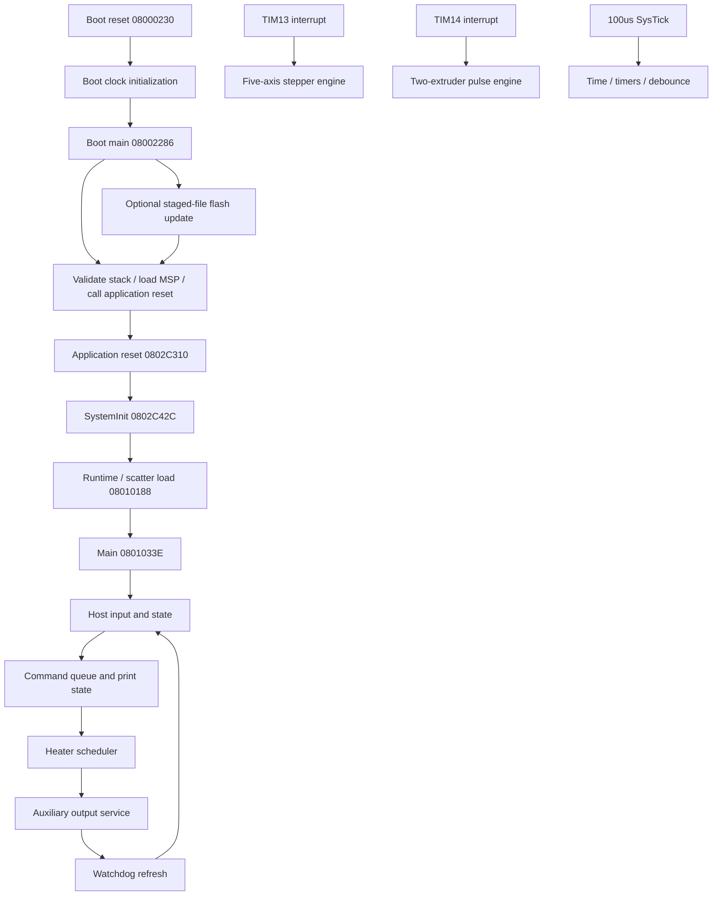

# FlashForge Creator Pro 2 firmware deconstruction

This is a substantial static reconstruction of the supplied firmware, not a claim that the original source has been recovered. The analysis recovered **2,317 functions**, traced the principal control paths, assigned **477 evidence-based semantic labels**, and exported **6,228 recovered call edges**. Many library functions, indirect calls, UI states and individual variables still need manual characterization. Decompiled C is pseudocode and is not suitable for rebuilding or flashing.

No printer connection, firmware write, erase, patch or flash operation was performed. The source BIN was opened for reading only. Changes were confined to separate Ghidra analysis databases and reports.

## Use the results

- Open **Firmware-Explorer.html** in a browser for offline search across every recovered function, its callers/callees, referenced strings and annotated pseudocode.
- Import **CreatorPro2-Analyzed.gzf** into Ghidra 12.2 or a compatible newer version. It contains the whole flash image, reconstructed application startup data, labels, comments and a recovered heater structure.
- Import **CreatorPro2-Bootloader-Analyzed.gzf** for bootloader-specific analysis. It models the bootloader's own initialized RAM rather than application RAM at the same addresses.
- **command-map.csv**, **motor-pin-table.csv**, **sensor-tables.csv**, **function-labels.tsv**, **call-graph.csv**, **hardware-references.csv**, **string-references.csv** and **bounded-switch-targets.csv** are companion reference tables.
- The **ghidra/** and **bootloader/** folders contain full decompiler output, disassembly, function indexes and instruction references. Use the bootloader folder for boot-specific RAM interpretations.

The GZF files are analysis containers, not replacement firmware files.

## Identity and validation

Source found on this PC: `C:\Users\tech\Desktop\creator pro backup.bin`. The earlier chat's `/mnt/data` path was unavailable.

| Property | Result |
|---|---|
| Length | 1,048,576 bytes / 0x100000 |
| Mapping | 0x08000000–0x080FFFFF, little-endian Cortex-M Thumb |
| SHA-256 | 45e8691c1866211de3b9f74b74d784a902e5d63e4f6eba0559a7528532376502 |
| Boot identity | Bootloader V1.3 20201210 |
| Application identity | V1.8 20210221; Flashforge Creator Pro 2 |
| Independent local comparison | Entire Desktop `creatorp2_v1.8_20210221.bin` matches dump offsets 0x10000–0xE4EDB |
| Application length | 872,156 bytes / 0xD4EDC |
| Archive validation | Whole-image GZF reimported into a separate Ghidra project; all 1 MiB of flash hashed identically to the source |

Matching the local application file establishes byte identity with that copy. It does not independently establish vendor authenticity or prove a flawless hardware acquisition. No cryptographic signature or vendor checksum was validated.

## 1. Overall architecture

The firmware uses a bootloader in the first 64 KiB, followed by an application starting at 0x08010000. The application has a cooperative main loop plus interrupt-driven motion, USB, SDIO and timekeeping. No RTOS task scheduler was identified in the inspected control path; that is not a proof that no scheduler-like library exists elsewhere.

### Main loop at 0x0801033E

Initialization calls:

1. Set VTOR to 0x08010000 through 0x0801030E.
2. Initialize board storage and I/O through 0x080157DC.
3. Select the serial EEPROM configuration path at 0x0801B04C.
4. Initialize subsystems through 0x080102CC, including UID, command state, machine settings and motion.
5. Configure the independent watchdog at 0x0801031C.
6. Enable interrupts as appropriate and initialize runtime/UI/heater state.

Then repeatedly:

| Address | Role |
|---|---|
| 0x08015358 | Host input and print/control state service |
| 0x08012AAA | Command queue, file input and waiting states |
| 0x08015A7C | Sensor/heater scheduling and UI refresh scheduling |
| 0x080183E6 | Timed auxiliary output task, exact product role still provisional |
| 0x080328CE | Write 0xAAAA to IWDG key register |

GUI service 0x0801BF32 is scheduled at nominal 10 ms intervals from the heater/service scheduler. Motion pulses run in separate interrupt paths.

## 2. Vectors, startup and memory

| Item | Bootloader | Application |
|---|---|---|
| Vector table | 0x08000000 | 0x08010000 |
| Initial MSP | 0x20005F28 | 0x2001D988 |
| Stored reset pointer | 0x08000231 | 0x0802C311 |
| Reset instruction | 0x08000230 | 0x0802C310 |
| SystemInit | 0x0800256C | 0x0802C42C |
| Runtime entry | 0x08000188 | 0x08010188 |
| Main | 0x08002286 | 0x0801033E |
| Default external IRQ | 0x0800024A | 0x0802C32A |

Both 98-word vector tables contain plausible stack values and zero/odd in-image handler pointers. Odd function pointers indicate Thumb mode; the instruction address is the pointer with bit 0 cleared.

The application reset stub calls SystemInit then branches to its runtime. SystemInit initially writes VTOR=0x08000000; main subsequently relocates VTOR to 0x08010000. This two-stage sequence is directly visible and explains why searching for just one vector-base write can be misleading.

### Application scatter-loading descriptors

Two 16-byte descriptors at 0x080E4A24:

| Source | Destination | Expanded length | Handler |
|---|---|---|---|
| 0x080E4B78 | 0x20000000 | 0xB68 | 0x080101C4, token decompression |
| 0x080E4EDC | 0x20000B68 | 0x1CE20 | 0x08010220, zero fill |

The decoder was reconstructed from instructions, and its output length and consumed input boundary were checked: **868 input bytes** expand to **2,920 bytes**, ending exactly at 0x080E4EDC. The zero-fill range ends at 0x2001D988. It includes linker-reserved startup storage; it should not all be assumed to be ordinary live variables.

This reconstruction is startup state derived from flash, not a capture of live RAM. Mutable globals can change immediately after boot, and EEPROM-loaded configuration is not recovered by this process.

Bootloader descriptors at 0x0800BE0C copy 0xB0 bytes from 0x0800C640 to 0x20000000 and zero-fill 0x5E78 bytes from 0x200000B0. Boot and application reuse the same SRAM addresses for different objects. The separate bootloader archive avoids conflating these lifetimes.

### Flash regions

| Region | Meaning |
|---|---|
| 0x08000000–0x0800C6EF | Boot vectors, code, constants and resources |
| 0x0800C6F0–0x0800FFFF | FF padding |
| 0x08010000–approximately 0x0804BFFF | Application vectors, code and interspersed constants |
| Approximately 0x0804C000–0x080E4A23 | Tables, fonts, localized UI data and other resources |
| 0x080E4A24 onward | Scatter metadata, runtime constants and compressed initialized data |
| 0x080E4EDC–0x080FFFFF | FF tail |

Code/resource boundaries are approximate. Tables and literal pools are interspersed within code regions.

Clock configuration is consistent with a 168 MHz core: initialized SystemCoreClock=168000000 at 0x200006C8; PLL register=0x07405408; APB1/APB2 divisors are configured in RCC. SysTick LOAD=SystemCoreClock/10000-1 and adds 100 to the software counter each tick, establishing a **100us tick and microsecond software time units**. Clock calculations assume the expected external oscillator and successful PLL startup.

## 3. Bootloader and update path

### Boot main: 0x08002286

Initializes hardware/display, attempts volume initialization, draws `0:start.bmp`, opens `1:/sys/creatorp.bin`, optionally performs programming, then calls 0x08009156 with application base 0x08010000.

### Program from file: 0x0800206A

- Opens staged application file for reading.
- Accepts file size up to 0xF0000 bytes in the inspected size check.
- Uses flash erase/program helpers covering the application sectors.
- Reads file data in 0x800-byte chunks.
- Passes complete 32-bit words to 0x08009108.
- Tracks progress and displays file/write errors or success.

The word programmer at 0x08009108 writes each word, reads it back and compares it. It returns distinct program-status and readback-mismatch errors. This is programming verification, not a cryptographic integrity check.

### Handoff: 0x08009156

Checks the application's initial stack pointer with mask 0x2FFE0000 against 0x20000000, loads its reset pointer, sets MSP when permitted, then calls that pointer. The inspected handoff does not establish full image authentication.

### Update staging inside the application: 0x080240E2

Opens `1:/Creatorp.bin`, creates/opens `1:/sys/Creatorp.bin`, reads an initial 4 bytes plus 16 bytes, then copies remaining data in 4 KiB chunks while refreshing the watchdog and updating a progress display. This is consistent with removing a **20-byte distribution header** before staging the raw application. The meaning of those 20 bytes was not established. No update file was supplied to or executed on the printer.

No signature validation was identified in these inspected staging/programming functions. This is a scoped observation, not a claim that every possible verification path has been excluded.

## 4. Communications and commands

There are two command routes. Host input may be handled immediately for status/control/file operations; other commands enter a ring for execution alongside print-file commands.

### Input and queue layout

| Address | Meaning |
|---|---|
| 0x20000B9C | Ten command slots, each 0x60 / 96 bytes |
| 0x2000003C | Read index |
| 0x2000003E | Write index |
| 0x20000040 | Queued count |
| 0x20001114 | Per-slot response/channel metadata |
| 0x200010B4 | Host line working buffer |
| 0x2000023C | Last parsed field cursor |

0x0801526C accumulates host characters. 0x0801287A accumulates print/file lines. Both recognize CR/LF, semicolon comments and the 95-character threshold. Queue insertion reports `buffer full` at ten entries. 0x08010662 searches for a field letter in the current command; 0x080105FA parses a following numeric value.

### Important dispatcher behavior

The detailed table is **command-map.csv**. Selected confirmed paths:

| Command | Address | Meaning from this binary |
|---|---|---|
| G0/G1 | 0x080109F0 | Parse coordinates/feedrate and plan linear move |
| G28 | 0x08010BDE | Homing-related target; full state naming remains provisional |
| M104 | 0x08010FA6 | Set extruder target from S and T |
| M140 | 0x0801104A | Set bed target from S if bed enabled |
| M105 | 0x08014BF8 | Report temperatures |
| M114 | within 0x08014C68 | Report X/Y/Z/A/B positions |
| M115 | within 0x08014C68 | Machine type/name, firmware, UID, dimensions and tool count |
| M119 | 0x0801490E | MachineStatus and MoveMode report |
| M28/M29 | 0x080143EA / 0x080143B4 | File write session handlers |
| M601/M602 | 0x080142DE / 0x08014388 | Claim/release host control |
| M112 | within 0x08014C68 | Calls motion stop/resynchronization and command-state reset |

**Do not substitute a generic Marlin command reference for this binary.** Some numeric commands have nonstandard behavior. M502 reports a FILAMENT value in the immediate path. Several queued commands, including M301/M304, appear to be acknowledged/consumed without invoking a tuning operation in this dispatcher. G91 also needs instruction-level follow-up: recognition alone does not establish standard relative-mode behavior. The traced immediate M112 path does not itself establish that all heaters are disabled.

No test commands were sent. These mappings are reverse-engineering observations, not operating instructions.

### USB

Reconstructed USB device descriptor at 0x200004FC:

`12 01 00 02 00 00 00 40 71 2B 0E 00 00 02 01 02 03 01`

Decoded: USB 2.00, endpoint-zero max packet 64, **VID 0x2B71**, **PID 0x000E**, bcdDevice=0x0200, manufacturer/product/serial indices 1/2/3, one configuration. Device-class byte is zero, so interface descriptors determine class. No claim of a standard CDC serial interface is made from the product name alone.

0x08029480 and neighboring callbacks generate product/manufacturer/serial/configuration/interface strings. 0x0802CFA6 constructs UTF-16LE USB string descriptors. Host response channel 1 uses USB endpoint **0x81** through 0x08028FA4. Receive callback 0x08029248 stores bytes in a **2048-byte ring at 0x2000A549**, with producer index at 0x20000730.

The reconstructed configuration descriptor at **0x20000780** is 46 bytes long and describes one interface with class/subclass/protocol **FF/FF/FF** (vendor specific), with four **bulk endpoints**, all max packet size 64:

| Endpoint | Direction |
|---|---|
| 0x01 | OUT / host to printer |
| 0x81 | IN / printer to host |
| 0x83 | IN / printer to host |
| 0x03 | OUT / host to printer |

Configuration attributes are 0xC0 and bMaxPower=0x32 (100 mA declared). This confirms a vendor-specific interface rather than standard CDC serial.

Receive handler **0x08029272** accepts textual packets beginning with `~`, tracks continuation when packet length is exactly 64, and otherwise has a raw file-transfer path. It recognizes short `~M29` packets to terminate a file session and handles `~M601` ownership failures. The raw transfer path accumulates data in a 4 KiB buffer, writes through the filesystem layer and tracks remaining bytes. This is framing logic in the firmware; no packets were transmitted.

The application USB interrupt 0x080161C6 calls the controller service at 0x0802EA06. SDIO and DMA2 Stream3 vectors delegate to 0x08019E70 and 0x08019F12.

## 5. Motion planning and step generation

### Execution chain

`G0/G1 handler 0x080109F0 → coordinate parsing 0x080106F4 → planner 0x0802BA16 → block ring → TIM13 IRQ 0x08017120 → 0x0802C2A8 → stepper engine 0x080295FC → axis advance 0x0804A3A8 → step/direction GPIO`

The planner converts five coordinate values into steps using per-axis scaling at offset +4 of each 0x30-byte axis state. It calculates deltas, path-length/feedrate quantities, direction masks and move blocks. The stepper engine updates timer auto-reload for acceleration, cruise and deceleration phases. Its arithmetic uses integer and software floating-point helpers.

| RAM | Meaning |
|---|---|
| 0x20009A9C | Block ring, 16 physical slots of 0x80 bytes |
| 0x200005B1 / 0x200005B2 | Ring head / tail |
| 0x20000538 | Current-block pointer |
| 0x2000A29C | Five axis states, stride 0x30 |
| 0x2000A38C | Step-position counters |
| 0x20000692 | Two signed pending extruder pulse counts |
| 0x200006AC | Relative-axis/mode mask used by planning |

0x08049D3C returns the current block or null if empty. 0x08049D18 advances the tail modulo 16. Sixteen physical slots do not by themselves prove that sixteen simultaneous queued moves are allowed; an empty-slot convention may reserve capacity.

### Interrupts

- **TIM13** at 0x40001C00: main stepper engine. 0x08017058 configures its prescaler from SystemCoreClock/4000000; later code varies ARR with motion speed.
- **TIM14** at 0x40002000: two-extruder pending-pulse path. Initial PSC=83 and ARR=99 are consistent with 10 kHz at an 84 MHz timer clock.
- 0x0802990C consumes signed counts for axes 3 and 4, writes direction, and generates pulses separately from the main DDA engine. Its exact relationship to extrusion compensation is still provisional.

### Recovered pin table

The initialized table at 0x200005BC uses five 0x28-byte entries. Step and direction roles are directly verified by 0x0804A224 and 0x0804A0E8. The enable pair is inferred from the adjacent motor-enable helpers. Board wiring and connector labels were not electrically tested.

| Axis index / inferred role | Step | Direction | Enable candidate | Input read as endstop |
|---|---|---|---|---|
| 0 / primary X | PB5 | PB6 | PB4 | PC6 |
| 1 / Y | PF8 | PF9 | PF7 | PG0 |
| 2 / Z | PF3 | PF4 | PF2 | PG1 |
| 3 / extruder 0 | PE0 | PE1 | PB9 | None in this table |
| 4 / extruder 1 | PE5 | PE6 | PE4 | None in this table |

Additional IDEX-related axis-0 branches explicitly manipulate **PC2 for pulses and PC3 for direction**. PC6 and PC7 are also debounced in SysTick and feed the dual-X control path. This is why the simple five-entry table alone does not fully describe the independent second carriage. The table's extra input pair at offsets 0x18/0x1C is exported but not given a definitive physical role.

Endstop read 0x0804A078 applies a per-axis polarity value. Step advance contains endstop checks, direction inversion, DDA accumulator updates, special IDEX branches and short busy delays around pulses. Physical pulse duration depends on clock and instruction timing; it was not measured.

### Recovered homing state sequence

The 13-entry TBB at 0x08011F40 was manually resolved into verified branch destinations. State is held at **0x20000088**. The recovered sequence is:

| State | Observed operation |
|---|---|
| 0 | Test completion/busy state; clear command-motion flag when complete |
| 1 | Mark axis 0 active; submit first homing phase; move to state 2 |
| 2 | Wait until planner queue count is zero; move to state 3 |
| 3 | Submit second axis-0 phase; move to state 4 |
| 4 | Wait; establish X position/scaling; choose Y, Z or completion according to requested axes |
| 5 | Submit first axis-1 phase; move to state 6 |
| 6 | Wait for empty planner queue; move to state 7 |
| 7 | Submit second axis-1 phase; move to state 8 |
| 8 | Wait; establish Y position; choose Z or completion |
| 9 | Submit first axis-2 phase; move to state 10 |
| 10 | Wait for empty planner queue; move to state 11 |
| 11 | Submit second axis-2 phase; move to state 12 |
| 12 | Wait; establish Z position, set a completion-related flag and return to state 0 |

Move helper **0x0802C0AC** has two phases: a direct configured displacement, or a negative configured offset followed by twice that distance at a different speed. Its exact physical approach/backoff directions depend on the signed per-axis tables at 0x080AE228–0x080AE24F and polarity/mode flags. Those constants and physical direction names need further annotation.

## 6. Temperature sensing and heater control

### Heater objects and channel mapping

| Object | Address | ID | Output |
|---|---|---|---|
| Extruder tool 0 | 0x20001E40 | 4 | TIM5 CCR4 / PA3 |
| Extruder tool 1 | 0x20001EEC | 3 | TIM5 CCR3 / PA2 |
| Bed | 0x20001F98 | 2 | PA1 GPIO |

Objects have a 0xAC-byte stride. Tool/channel assignment is confirmed by 0x0801588E initialization and M104's T selection. PA2/PA3 are configured for TIM5 alternate function at 0x080179E4. PWM uses PSC=335 and ARR=255, consistent with roughly 976.6 Hz at 84 MHz timer input. The bed path switches PA1 according to whether requested output is below 11; it does not use the same PWM channel.

### Sensor paths

**Bed:** 0x080176F8 stores readings in an eight-sample ring, invokes an ordering/filter routine, averages the middle four values and interpolates table 0 at 0x0804C5B4. A converted value >=131 returns sensor status 4. The raw source is associated with on-chip ADC handling; a complete channel-to-pin audit remains outstanding.

**Extruders:** 0x08017884 uses SPI3 at 0x40003C00, PC10/PC11/PC12, and PF12 chip select. It cycles channel configuration words 0x0C62, 0x3C62 and 0x0072, performs word transfers, converts signed readings through table 1 at 0x0804C604, adds a reference/auxiliary compensation value and records per-channel results. Raw sentinel 0x7FFF produces status 3; out-of-range conversion produces status 4. Exact external converter part identification is unresolved.

**sensor-tables.csv** contains the two relevant packed signed16 raw/temperature tables. Bed has 20 entries. The contiguous extruder table contains 29 entries, but the shared interpolation function's search upper bound is 19; this makes the >240-range behavior worth focused follow-up. It should not be interpreted as an extra configurable temperature range.

### Scheduler

0x08015A7C arms sensor/heater service timers for 250000 microseconds. The two extruder updates alternate according to completed sensor channel; nominal each-extruder control cadence is around 500 ms, plus reference-cycle and loop effects. Bed service is nominal 250 ms when enabled. GUI service is separately scheduled for 10000 microseconds.

### Target limits and controller

0x08017C98 clamps targets to **120 for heater ID 2** and **240 for the other heater IDs** and clamps negative values to zero. Temperature units are strongly supported as Celsius by table contents and command/UI use. These are observed limits in this image, not recommended settings.

PID at 0x08015C10:

- Computes target minus measured input.
- Accumulates error with literal clamp values corresponding to -256 and +256.
- Keeps four recent error differences in a ring and maintains their running sum.
- Combines proportional, integral and derivative terms.
- Converts the result to integer and doubles it.
- Heater control clamps the requested output to 0..255.

Fallback gain literals at 0x08017BC8 correspond to **Kp=50, Ki≈0.325, Kd=36**. The routine can load gains from machine configuration first; these literals are not proof of the gains currently stored on the printer. Some floating-point compare helpers use condition flags and remain awkward in the decompiler.

When far below target, control can use full output rather than PID. Hysteresis thresholds in the inspected branches are 25 and 14 temperature units. Controller state is reset when transitioning back to PID. A target change greater than 10 resets the PID history in 0x08015CDE.

### Fault checks and shutdown

0x08017E7C contains the following checks when their mode/bypass flags allow them:

| Condition | Recorded code |
|---|---|
| Sensor status outside handled success/busy states | 0x02 |
| Measured temperature >260 | 0x04 |
| After rise-check timer, below starting temperature +5 | 0x08 |
| After long timer and ready-state check, more than 30 below target | 0x10 |
| Sensor status 4 / range failure | 0x20 |

Counters are compared against 50. The code increments counters in several branches and may share a counter across thermal conditions, so it is not sound to turn every check into a single exact real-world timeout by multiplying samples. Target setup arms literals corresponding to **40 seconds** for certain cold-start rise checks and **300 seconds** for longer monitoring.

0x08017E52 explicitly:

1. Sets the object's fault-disabled flag at +0x65.
2. Calls target-setting with zero.
3. Calls the output writer with zero.
4. Records fault code and heater ID through 0x0801595C.

The fault word is at 0x20000248; it combines code bits with a heater ID in bits starting at bit 8. This establishes a real output-disable path rather than relying on UI error strings alone. It is not a complete safety validation: flag provenance, all bypass/configuration branches, fault recovery and physical output behavior still require further examination.

### Recovered structure fields

| Offset | Meaning |
|---|---|
| +0x24 | measured temperature, signed16 |
| +0x26 | temperature recorded when target changes |
| +0x30/+0x34/+0x38 | PID gains |
| +0x5C | PID target, signed32 |
| +0x64 | full-output control state |
| +0x65 | fault-disabled latch |
| +0x66 | sensor fault counter |
| +0x67 | shared thermal counter |
| +0x68 | fault code |
| +0x6C/+0x7C | monitoring timer structures |
| +0x8C | initial rise confirmed flag |
| +0x8E/+0x8F | check/control bypass flags; full provenance unresolved |
| +0x90 | heater ID |
| +0x94 onward | auxiliary hysteresis-control state, product role provisional |

## 7. Settings, filesystem and display

### Settings

Machine configuration is assembled at 0x20000110. 0x08013D70 reads profile/machine fields and temperature defaults. The configuration access layer can address backup SRAM at 0x40024000 or a serial EEPROM path. Main calls 0x0801B04C, which selects the serial path in the inspected startup flow.

0x0801B306 and 0x0801B43C implement byte reads/writes through bitbanged serial transactions with address bytes 0xA0/0xA1. This supports an I²C-compatible EEPROM interpretation. The precise memory part, complete map and current stored calibration are not determined by internal flash alone. Read helpers substitute defaults for 0xFF bytes.

UID initialization at 0x08013FE2 reads three words from 0x1FFF7A10. Those hardware UID bytes are outside this flash dump; the dump does not reveal the printer's actual UID simply because the firmware can print it.

### Filesystems

Unicode file paths, file objects of roughly 0x228 bytes, volume mounts, file read/write/close patterns and FAT-related literals are consistent with a FatFs-style filesystem layer. Exact version attribution is not established. Semantic comparison with the original Elm-Chan FatFs R0.09b source identified the application filesystem APIs and internal helper algorithms; exact release/build attribution remains unproven. The open/read/write/close APIs are now named at 0x0803429C, 0x08034400, 0x080345DA and 0x080348B2. Storage includes SDIO/DMA and SPI-backed paths.

Drive `0:` is used for display/font assets; drive `1:` for print/update files. Disk dispatch at 0x08032944/0x080329BA/0x08032AB6 confirms drive 0 uses serial flash and drive 1 uses the SD path. Drive 0 initialization checks JEDEC ID 0xEF4018. This is an observed ID expectation, not a read of the actual installed part.

### GUI and resources

0x0801BF32 invokes a current-page callback through pointer 0x20000374 and services GUI/update routines. UI status text is copied at 0x0801BF5C. Window/widget lookups, progress values, dialog callbacks and page state machines are visible throughout roughly 0x0801BC00–0x080287FF and the later GUI library region.

0x08037706 loads `korean.xbf`, `yahei24.xbf` and `yahei24 4AA.xbf` as available, then selects font/language resources. 0x0801BC6A checks `Font18.bin` and chooses an initial resource base. Language table base is stored at 0x20000384; message references frequently use offsets from that base, so direct ASCII cross-references are incomplete.

The large region around 0x08098308 onward includes repeated localized UI blocks. An observed stride of **0x2012 / 8210 bytes** appears between repeated language-selector strings. English resource text near 0x0809A31A includes preheat, connection, heating and fault messages. Font/bitmap-like data occupy substantial flash ranges; high entropy there is not enough to identify encryption or a specific compression format.

The firmware names external font files and a startup bitmap, so the 1 MiB internal flash image is not a complete backup of all display assets, EEPROM settings, removable storage, backup SRAM, MCU option bytes or system ROM.

## 8. Analysis limits and remaining work

This pass covered image structure, vectors, startup decompression, normal Ghidra analysis, complete recovered-function export, direct call/reference indexing, principal subsystem tracing, semantic labels, hardware pin tables, command routes and selected state-table edges.

Important unresolved items:

- 1,872 of the 2,220 recovered functions do not yet have a curated semantic label. Some additional startup/vector names exist but are not counted as manually characterized. A decompiler return value alone does not characterize a function.
- Six bounded TBB switches now have explicit Ghidra jump overrides, including homing, command service, sensor status, UI heating and language selection. **bounded-switch-targets.csv** preserves exact index-to-address mappings. The decompiler renders some cases as destination pointers; not every remaining UI/print state has been semantically named.
- Indirect callbacks and tail calls mean the 6,000-edge call graph is incomplete. Function sizes are Ghidra body-address counts, not proof of unique code coverage.
- The decompiler reports bad-instruction flow at 0x0804AB3C for several software floating-point helpers. A reported successful decompile can still contain this warning. Decompiled condition flags, `extraout_` values and `unaff_` registers are not reliable source variables.
- Function signatures and recovered structures need additional refinement. The principal heater and PID parameters now have explicit recovered pointer types. Compiler helper calling conventions still cause artifacts such as `extraout_r3`; the raw instructions take precedence.
- Several standard-looking command numbers have nonstandard or apparent no-op branches. Their exact protocol intent needs caller/state analysis; no behavior should be inferred from number alone.
- EEPROM calibration, external sensor part identity, complete ADC pin routing, physical IDEX wiring and every GUI asset are not fully reconstructed.
- Runtime timing, interrupt latency, actual output polarity and fault behavior were not measured on hardware.

### Next focused static passes

1. Finish semantic naming of command-service and UI state branches; recover the remaining indirect switches using the same bounded-table method.
2. Audit IDEX transforms and homing from 0x080106F4, 0x08010BDE, 0x08011F34 and 0x0804A3A8; distinguish left/right carriage state and limit handling.
3. Recover every configuration offset from 0x08013D70 and its helpers; distinguish defaults from EEPROM-loaded values.
4. Trace thermal bypass flags, fault recovery, all stop paths and command-specific heating waits; audit all bypass/recovery callers. The table boundary above entry 19 has now been confirmed by instruction emulation (see pass 2 below).
5. Trace endpoint callback registration and all channel ownership states beyond the recovered vendor-specific descriptors and `~` packet framing.
6. Recover GUI page registration tables, language-block encodings and external asset formats.
7. Identify software floating-point/standard-library functions and repair their special exception/tail-flow signatures to reduce decompiler artifacts.

## 9. Deeper validation and reconstruction — pass 2

### What the counts mean

There is no defensible “100% deconstructed” percentage from automatic disassembly. All 1,048,576 supplied flash bytes are preserved, and all 2,220 currently recovered functions are exported, but undiscovered functions, shared tails, indirect calls and resource interpretation remain possible. **477 functions have curated semantic labels; 1,840 do not.** Label counts measure navigation and characterized roles, not branch-level proof. `coverage-inventory.json` gives regional counts, and `remaining-functions.csv` lists outstanding functions by recovered body size. The 62 recovered functions in the selected filesystem region all have semantic labels; this does not prove every branch of that region.

### Original-instruction checks

The numeric and thermal verification files record offline Unicorn execution of the original ARM instructions. No code was sent to a printer. Numeric tests use mapped flash and reconstructed startup RAM. Thermal tests substitute deterministic sensor values, time/expiry, readiness and output-driver interfaces; they test the control routine, not actual ADC/SPI timing, electrical output or hardware safety.

- Five finite arithmetic cases establish add/divide/multiply/subtract/reverse-subtract wrapper roles.
- Two simple PID examples and a deterministic **128-sample** sequence agree with a separately reconstructed float32 algorithm. This covers positive/negative errors, integral clamping to ±256, ring history wrap and truncation before doubling. It does not establish NaN, infinity, overflow or every possible input.
- With gains 1, 0.5, 0.25, target 100 and initial state zero: measured 90 gives **34**, then measured 92 gives **38**. The weighted sum is converted to integer before multiplication by two. `Recovered-PID-Reference.c` is a readable finite-input model, not replacement firmware.
- Target 999 clamps to **120 for heater ID 2** and **240 for ID 4**; a negative target clamps to zero. Fault-disabled/control-bypass fields inhibit a nonzero target.
- Five isolated fault conditions trip on the **51st tested update call**: sensor status 3 → code 2; sensor status 4 → code 0x20; temperature 261 → code 4; insufficient rise with the timer expired → code 8; sustained deficit with timeout and readiness true → code 0x10. Each tested path sets disabled=1, clears the target, calls output(heater,0), and records code | (heater_id << 8).
- Busy statuses 1/2 do not increment the sensor-fault counter across 60 tested updates. A cold target produces 255 requested output; zero target produces zero. Counters can interact when multiple checks fail simultaneously, so 51 calls is not a universal wall-clock shutdown latency.

### Confirmed table boundary

`Sensor_TableInterpolate` at 0x080175B8 uses search bounds 0..19. Although the contiguous extruder table contains 29 pairs, this routine does not search its final nine entries. Original-instruction execution for table 1 returns 240 at raw 1247 and the caller-supplied cap 400 at raw 1248 and 2152. This is real behavior of the tested interpolation call, not just decompiler output. The SPI pipeline adds cold-junction compensation later, so these standalone results are not a complete physical-temperature calibration. Bed examples: raw 1721 → 126; raw 4086 → signed -29 (stored as 0xFFFFFFE3 in r0).

### Sensor identity inference

The SPI command words 0x0C62, 0x3C62 and 0x0072, paired differential channels and signed internal-temperature conversion at 0.03125 °C/LSB strongly match **TI ADS1118**. Config decoding yields differential AIN0–AIN1 / AIN2–AIN3, ±256 mV range and 64 SPS; 0x0072 selects its temperature sensor. This is a high-confidence inference from firmware behavior and the [TI ADS1118 datasheet](https://www.ti.com/lit/ds/symlink/ads1118.pdf), not physical chip-marking verification. The exact thermocouple type and board routing remain unverified.

### Libraries and compiler conventions

The filesystem algorithms, constants, object offsets and ordering were compared with the [original Elm-Chan FatFs R0.09b source archive](https://elm-chan.org/fsw/ff/arc/ff9b.zip). Named routines include FAT12/16/32 cluster operations, long filenames, path traversal, mount/open/read/write/sync/seek, directory enumeration, free-space, delete/mkdir/rename/format and UTF conversion. These are semantic matches, not a binary-identical source rebuild. STM32 peripheral helpers were named from register operations; confidence is lower for larger routines whose full original source has not been matched.

Float32 wrappers now have explicit r0/r1 storage and float types. Comparisons return **processor flags**, which ordinary C signatures do not express. An inline comparison experiment destabilized decompilation and was reverted; the final export contains no failed decompilations, but retains the four known bad-instruction warnings. `Runtime_F64_ExceptionDispatch` at 0x0804B1F8 reads a descriptor at aligned LR and restores the caller's stack; the embedded word around 0x0804AB3C is not evidence of corrupted flash. Its unusual return/dispatch convention still needs a custom analysis model. Ghidra “Unknown calling convention” annotations on explicitly assigned register storage are analysis limitations, not firmware faults.

### Display resources and indirect callbacks

`ui-language-catalog.csv` contains **1,803 readable UTF-8 runs** from ten fixed-size 0x2012-byte resource blocks: Simplified Chinese, English, Traditional Chinese, Japanese, German, Korean, French, Polish, Spanish and Portuguese. The block index is a resource index; selected-language behavior depends on external font availability and includes fallbacks. Candidate runs are decoded text, not proof of 1,803 distinct UI fields; duplicate/short strings remain.

`ui-page-callbacks.csv` recovers **19 assignments** to the periodic page callback at 0x20000374 and nearby dialog table/event callback registrations where statically visible. Thumb bits are cleared in callback addresses. This supplements the direct call graph; it is not a full dynamic page-transition graph. Page names and every widget event still need interpretation.

### Configuration checks added to pass 2

`configuration-map.csv` records 15 storage offsets with their observed roles, defaults and limitations. `settings-emulation-verification.json` records a serial-backend startup path with deterministic external-read stubs; it is not a dump of the printer's saved settings. The trace requests profile 0x12, language 1, temperature fields 240/240/120, a 34-byte name block at 0x40 and additional fields at 0x28/0x69/0x6B.

Seven finite tests of the X-offset loader at 0x08013BCA show strict bounds: -4, 0 and 4 pass through; -6, -5, 5 and 6 return +5. The Y/Z loaders have parallel code but were not separately emulated. The float default helper at 0x08013828 uses float word **0x4F800000 (4294967296.0)** as the equality sentinel. With default 2.5, that word returns 2.5; words 0 and 0x3F800000 return 0.0 and 1.0; **0xFFFFFFFF passes through as NaN** in the tested path. This is distinct from the integer helpers' all-ones default convention. No stored EEPROM value was changed or read from hardware.

### Remaining recovery limits

The original variable names, comments, source organization and build environment are stripped. External serial-flash assets, EEPROM calibration, backup SRAM, MCU UID/option bytes and live execution state are outside this dump. More static work can characterize the remaining 1,872 functions, especially UI/library internals and IDEX transforms, but it cannot supply absent captured data or establish real hardware timing. A source-equivalent, rebuildable firmware or complete behavioral proof has **not** been achieved.

The updated GZF was reimported into an independent project: **2,220 functions, 380 nonautomatic names**, and the same 1 MiB flash SHA-256. The distinction between 380 nonautomatic names and 348 curated labels is intentional: startup/vector names are also present. Use the curated-label table for the conservative count.

## 10. Profile and IDEX selector follow-up

See **IDEX-and-Profile-Findings.md** and **idex-selector-verification.json** for the detailed trace and test limits.

- The 0x11/0x12 profile selector is shown in the UI as **Silver/Black**, respectively. Both initialized motion-table rows match; no performance unlock was found.
- M611 S1 selects persistent single-extruder configuration; S2 selects dual. This affects home offsets, UI/reporting and second-heater startup behavior, so it is not an advanced-mode unlock.
- M118 processes first/last T and a requested D mode as job-header metadata; D1/D2 arm a larger IDEX compensation/setup workflow. Omitting D can retain the previous requested mode.
- M111 T1 enables both carriages with opposite logical X counter changes; M111 T2 enables both with matching changes in the tested original-instruction step path. These correspond to mirror and duplicate behavior. No hardware outputs were driven.
- The coordinate parser has separate +/-66 compensation transforms, and the queue service uses calibration-pad markers and stored internal command sequences. Requested mode, compensation-pass mode and active synchronized mode are distinct RAM fields.
- These are existing Creator Pro 2 capabilities documented by FlashForge. The installed FlashPrint 5 also contains ditto-print settings. A full slicer-generated job is the practical route; raw command fragments here are analysis references, not complete initialization instructions.

No printer setting, firmware byte or connected device was changed. Eight additional functions received curated labels, bringing the total to 348; the recovered-function count remains 2,220.

## 11. Pause/resume control-flow repair

The bounded seven-entry branch at 0x080121B2 now has explicit targets in Ghidra. This exposes resume states 0x81 through 0x87, including the intentionally unhandled state 0x82. Offline checks passed 13 transitions and seven wait conditions using original state-dispatch instructions and simulated subsystem responses. See **Print-Pause-Resume-Findings.md** and **print-state-verification.json** for the sequence and test limits. This is control-flow recovery, not a hardware motion/heating validation.

## Primary documentation used for hardware interpretation

- [ST STM32F407 datasheet: memory and device capabilities](https://www.st.com/resource/en/datasheet/stm32f407vg.pdf)
- [ST RM0090: registers, interrupt map and timers](https://www.st.com/resource/en/reference_manual/rm0090-stm32f407-advanced-armbased-32bit-mcus-stmicroelectronics.pdf)
- [Ghidra official Thumb disassembly help](https://github.com/NationalSecurityAgency/ghidra/blob/master/Ghidra/Features/Base/src/main/help/help/topics/DisassemblerPlugin/Disassembly.htm)

Firmware-specific addresses and behaviors in this report are derived from the supplied bytes and local Ghidra results. Hardware names apply under the user's stated STM32F407 target assumption.

## 12. Expert Mode and deeper UI reconstruction

Expert Mode is reachable through the Settings callback and provides staged X/Y fine calibration in 0.05 increments. OK adds and persists the deltas; Cancel clears them. Nine isolated original-instruction checks passed with GUI and persistence interfaces intercepted. See **Expert-Mode-and-UI-Findings.md** for addresses, limits and practical steps.

The UI pass adds 83 semantic labels (431 total), typed message pointers for 45 functions, and catalogs 33 distinct widget tables. The Silver/Black selector is titled **Pulley Type**, correcting earlier case-variant interpretations. No performance unlock was established. Earlier section counts describe their respective passes; the current inventory and archive supersede them. All 2,220 recovered functions still decompile successfully; four previously documented numeric-helper warnings remain.

## 13. Queued-command instruction checks

Thirty additional original-instruction checks resolve several earlier dispatch uncertainties. G91 consumes its queue entry and leaves the relative-axis mask at 0x200006AC unchanged for starting masks 0, 1 and 31. G90 clears that mask and increments the change counter. G161 follows a consume-only path; G162 calls 0x080116A4. M146, M201, M204, M205, M206, M221, M301, M304, M612 and M999 all reach the intercepted common response helper with no other dispatched action in these tests. This is evidence about this dump and route, not universal G-code behavior.

G28, G93, M18, M108, M109, M110, M111 and M906 retain the queue entry when the motion-ready predicate returns false. External handlers and decimal parsing were intercepted; field search and finite numeric conversion used original instructions. See `dispatch-emulation-verification.json` and the updated command map. Nothing was sent to a printer.

Final UI-pass archive reimport confirms 2,220 functions, 463 nonautomatic names, 431 curated labels and the original 1 MiB flash SHA-256. Extra startup/vector names explain the difference between nonautomatic and curated counts. The offline explorer was checked against the new counts and typed Expert Mode callback.

## 14. Service paths and usage accounting

The service pass identifies M615 and the startup marker-file helper as print-time counter resets, resolves storage offsets 0x69/0x6B as cumulative hours/minute remainder, and verifies timer pause/wrap behavior. Fourteen usage/service cases, 2,010 immediate-routing cases and six G162 cases passed under the documented emulator stubs. See **Service-and-Command-Findings.md** for the exact path, addresses, routing lists and evidence limits. Sixteen additional functions bring curated labels to **447**; all **2,220** recovered functions remain exported. This does not constitute complete reverse engineering or an established feature unlock.

## 15. Motion/runtime reconstruction and completed desktop analysis

The completed desktop run added 97 function entry points, all now incorporated after one reviewed shared-tail split. The current combined program has **2,317 recovered functions and 477 curated labels**. See **Deep-Analysis-Review.md** for integrity/boundary checks and **Motion-Planner-and-Runtime-Findings.md** for typed 128-byte motion blocks, restored flag-return dataflow, existing extrusion advance, acceleration/ring checks and their limits. Earlier section counts and descriptions refer to earlier passes. The four previous bad-instruction warnings are resolved by modeled exception call-return flow; the F32 comparison leaf C limitation remains explicitly documented.

The merged export has two automatic C-structuring failures at 0x08002EE8 and 0x08018A54, also present in the user-run export. Both SD bus-width routines have separately reconstructed control flow validated in 18 original-instruction cases. See **Decompiler-Limits-and-SD-Reconstruction.md** and **Recovered-SD-BusWidth-Reference.c**; raw decompiler failure markers are preserved.
